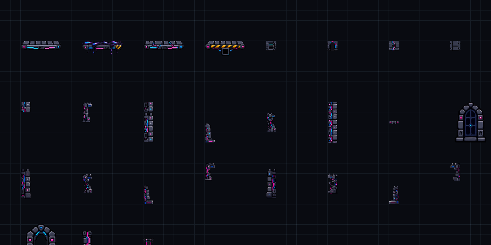

# 칸별 팔레트·입체 발판·중앙 추적·점프 잔상

메인 씬과 비교 씬 15개를 모두 수정했습니다. 메인은 **09 RGB 키보드**이며, 기존 106개 발판의 ID·물리 표면·좌표·너비·경사·이동 설정은 보존했습니다.

## 편집 시작

Unity 메뉴 **일시정지 게임 → 팔레트 → 09 RGB 메인 편집 열기**를 누릅니다. 팔레트에서 한 칸만 고르거나, 아래 표의 전체 묶음을 드래그해 선택한 뒤 Scene에 칠하세요.

| 디자인 | 전체 묶음 | 한 칸 |
|---|---|---|
| 일반 발판 | 가로 4 × 세로 1 | 32 × 32픽셀 |
| 기름 발판 | 가로 4 × 세로 2 | 32 × 32픽셀 |
| 금간 발판 | 가로 4 × 세로 1 | 32 × 32픽셀 |
| 타이머 발판 | 가로 4 × 세로 2 | 32 × 32픽셀 |
| 뒤 성벽 | 가로 1 × 세로 1 | 32 × 32픽셀, 표시 배율 **1.01** |
| 옆 성벽 | 가로 1 × 세로 4 | 32 × 32픽셀, 공통 도트 밀도 |
| RGB 원본 좌우 몸통·RGB 배선 기둥 | 가로 1 × 세로 3 | 32 × 32픽셀, 원본 비율 유지 |

창틀도 4×4 묶음의 한 칸 조각으로 나눴습니다. 한 장을 여러 칸에 걸쳐 놓는 방식에서 실제 칸별 Tile로 바꿨습니다. RGB 벽 세 묶음을 3칸으로 줄인 현재 팔레트에는 **서로 다른 분할 조각 1,576개**가 있습니다. 기존 331개 전체 그림 타일은 연결 호환용으로 보존하며 기본 팔레트에는 분할 조각을 표시합니다.

RGB 왼쪽 몸통·오른쪽 몸통·배선 기둥은 32×96픽셀 전체 그림을 세 조각으로 분할합니다. 09 메인 팔레트와 전체 모음 양쪽에 적용했으며, 재생성 메뉴에서도 3칸 규격을 유지합니다. [수정 전후 비교](../WallThreeCells20261021/Comparison.png)와 [해당 자산 검사 결과](../WallThreeCells20261021/Validation.txt)를 참고하세요.

Tile Palette의 **Active Tilemap**에서 칠할 대상을 고릅니다.

- **01 성 내부 벽**: 뒤 성벽·빈칸 채우기. 실제 1m 격자를 사용하고, 각 그림은 1.01배 겹칩니다. 투명한 모서리도 재질 바탕으로 채워 성벽 사이로 배경이 새지 않습니다.
- **02 창문 레이어**: 창틀과 그 안쪽 투명 구멍. 기존 큰 창문은 유지했습니다. 분할 창문도 이 레이어에 칠하면 안쪽 너머로 구름·원경이 보입니다.
- **03 발판 추가**: 칠한 발판을 다음 Play에서 실제 물리·예측에 함께 반영합니다. 윗줄 네 조각은 한 발판으로 묶이고, 기름·타이머의 아랫줄은 별도 착지 판정을 만들지 않습니다. 타이머가 사라지면 위아래 여덟 조각과 숫자가 함께 사라집니다.

조각 이름의 `열,행`은 왼쪽 위부터의 위치입니다. 윗줄 한 칸만 칠하면 한 칸 너비의 표면을 만들 수 있습니다. 아랫줄 장식만 놓으면 착지 판정이 없습니다. 같은 묶음을 만들 때는 각 조각의 열·행 순서를 맞추세요.

## 캐릭터가 발판 윗면 안쪽에 서는 표현

실제 충돌 높이를 바꾸지 않고 발판 그림을 **0.2m 위로** 올렸습니다. 첫 발판의 `발판 도트 · Normal 0` Y는 약 **-0.190085**입니다. 기름막·타이머 숫자도 함께 맞췄습니다.

기존 개별 발판의 Inspector에서 **발이 서는 입체 윗면 → Visual Surface Inset** 값을 조절할 수 있습니다. 디자인을 다시 적용하면 해당 깊이를 사용합니다. 값이 클수록 캐릭터가 윗면 안쪽에 서 보입니다. 분할 발판의 기본 물리 표면도 그림 맨 위보다 0.2m 아래입니다.

2026-10-22 메인 씬에는 기존 발판 106개와 옆 성벽 2개 자체에도 편집 Tilemap을 추가했습니다. 각 발판·성벽 Inspector의 **이 발판의 Tilemap 칠하기 / 이 성벽의 Tilemap 칠하기**로 대상을 선택합니다. 기존 그림의 타일 수정과 새로운 물리 발판 추가를 구분하는 방법은 [발판과 옆 성벽 Tilemap 편집 안내](../../2026-10-22-발판과-옆성벽-Tilemap-편집.md)를 참고하세요.

기존 발판의 외형 교체는 Inspector의 **팔레트에서 고른 발판 디자인 적용**을 사용합니다. 한 조각을 골라도 전체 발판 그림을 적용합니다. 기존 위치·너비·경사와 엔딩 발판 역할은 유지합니다.

## 카메라

시작 구간에서는 성 중앙 화면을 유지하다가, 캐릭터가 **가로 중앙을 통과하는 순간**부터 좌우로 따라갑니다. 두 물리 프레임 사이에 중앙을 넘어가도 감지합니다. 가장자리에서는 화면 끝에 성 바깥이 기본 **1.5m**만 추가로 보이는 위치까지 이동한 뒤 멈춥니다.

실제 외벽 안쪽 좌표와 카메라의 화면비·줌을 사용해 제한을 계산합니다. 화면 자체가 성보다 넓으면 중앙을 유지합니다. `Pause Batch Camera`의 **성 가장자리 화면 제한**에서 바깥 노출 폭·완충 시간을 조절할 수 있습니다. 중앙 판정과 추적 여유의 기본값은 0.15m입니다.

예약 점프 중에도 가로 추적은 작동합니다. 세로는 기존 규칙을 유지해 예약 묶음 중 고정하고, 큰 낙하가 시작되면 반동 상승·하강·회복이 끝날 때까지 따라갑니다. ESC 정지 중에는 가로·세로 자동 추적이 모두 멈춥니다. 휠 둘러보기와 ESC·휠 클릭 복귀도 유지합니다.

## 점프 잔상

점선·반사점·착지 번호를 제거하고 실제 사람 PNG의 반투명 잔상으로 바꿨습니다. **60Hz 물리의 3프레임, 즉 0.05초 간격**으로 발 위치와 같은 시점의 자세를 표시합니다. 상승·정점·하강·좌우 벽 반동·회복은 실제 캐릭터와 같은 모션 계산을 사용합니다.

`Pause Trajectory Ghost View`에서 잔상의 투명도와 색을 조절합니다. 예측은 복사 모델에서 계산하므로 실제 위치·시간·예약을 진행시키지 않습니다. 기존 초반 가이드 노출 규칙(현재 높이 6m까지 선명, 6~12m에서 사라짐)은 유지했습니다. 실제 재생을 시작하면 잔상은 숨깁니다.

## 저장 위치와 검증

- 메인: `Assets/Scenes/MainScene.unity`
- 비교 씬: `Assets/Scenes/DesignStages`
- 팔레트: `Assets/Palettes/StageDesigns`
- 조각 타일: `Assets/Tiles/StageDesigns/각 테마/칸별 분할`
- 편집용 격자 그림: `Assets/Art/RGBMain20261021/Grid32`
- 검증 기록: `Docs/Validation/GridRevision20261021`

원본 PNG는 보존하고 편집용 자산을 최근접 필터로 정규화했습니다. 자동 디자인 적용 메뉴는 제작 도구이므로 수동으로 외형을 다듬은 뒤 일괄 재적용하면 해당 제작 도구의 스킨이 다시 적용됩니다. 일반 편집에는 팔레트 열기 메뉴를 사용하세요.

`Validation.json`은 16씬 배치 보존·팔레트 규격·입체 윗면·가로 카메라 제한·3프레임 잔상 위치/자세·분할 발판 저장과 판정을 검사합니다. `Runtime/RuntimeValidation.json`과 PNG는 실제 Unity Editor 재생에서 메인과 15씬의 첫 두 도약·시차·정지·원색 복구, 메인의 잔상과 3/2/1 타이머를 확인한 기록입니다. 카메라 양끝의 고립 검사는 위치 준비에 Reset을 사용합니다.

175m 전체 완주·Android 실기기·성능은 이번 검사 범위에 포함하지 않습니다. 기존 Windows/APK 실행 파일에는 이번 수정이 포함되지 않습니다.
